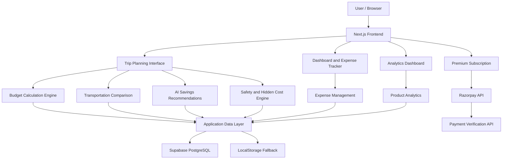

# ✈️ Smart Travel Budget Planner – TravelBudget

**An Intelligent Travel Planning and Budget Optimization Platform**

TravelBudget is a smart travel planning application designed to help travelers plan trips, estimate expenses, compare transportation options, discover destination experiences, and manage their travel budgets.

The platform combines algorithm-based financial estimation, AI-assisted savings recommendations, safety-aware planning, expense tracking, and product analytics into one integrated application.

It helps travelers answer an important question:

**How can I plan a better travel experience without exceeding my budget?**

---

## 🌍 1. Project Overview

Planning a trip involves more than booking transportation and accommodation. Travelers often overlook additional expenses, struggle to compare different travel options, and find it difficult to track actual spending against their original budget.

TravelBudget addresses these challenges through an integrated planning and financial intelligence system.

### Key Objectives

- Estimate total trip expenses before travelling.
- Compare flights, trains, and buses to identify cost-effective options.
- Recommend ways to reduce travel expenses.
- Discover popular destinations, attractions, and regional food.
- Calculate local transportation expenses across multiple stops.
- Identify hidden costs before departure.
- Provide safety-aware travel recommendations.
- Track actual expenses against planned budgets.
- Analyze user engagement and product conversion through analytics.

---

## ✨ 2. Key Features

### 1. Smart Travel Budget Estimation

Calculates an estimated travel budget based on the traveler's preferences and trip details.

**Inputs:**
- Starting location and destination.
- Travel dates and trip duration.
- Number of travelers.
- Travel style: Budget, Standard, or Premium.
- Transportation preference.
- Accommodation preference.
- Food preference.
- Sightseeing and activity preferences.
- Maximum available budget.

**How it works:**

The budget calculation engine processes these inputs and calculates estimated expenses across multiple categories.

| Expense Category | Calculation |
|---|---|
| Transportation | Selected transport mode and number of travelers |
| Accommodation | Room rates × rooms required × nights |
| Food | Daily food allowance × travelers × duration |
| Local Transport | Estimated intra-city transportation |
| Activities | Estimated sightseeing and activity expenses |
| Miscellaneous | Additional expenses and contingency |

**Output:** An itemized budget breakdown, total estimated cost, and comparison against the maximum available budget.

### 2. AI-Assisted Travel Savings Assistant

Provides personalized recommendations to help travelers reduce their estimated expenses.

**Capabilities:**
- Identifies expensive budget categories.
- Suggests alternative transportation options.
- Recommends affordable accommodation.
- Suggests economical food choices.
- Recommends lower-cost sightseeing alternatives.
- Calculates estimated savings in Indian Rupees.
- Explains why each recommendation can reduce expenses.

The current implementation uses a built-in rule-based recommendation engine. This allows recommendations to work without requiring an external AI API.

An optional AI API configuration is provided for future integration.

### 3. Smart Transportation Comparison Engine

Compares different intercity transportation options based on estimated cost, duration, and additional expenses.

**Transportation modes:**
- Flight
- Train
- Bus

**Comparison factors:**
- Estimated ticket prices.
- Travel duration.
- Baggage-related costs.
- Destination-to-hotel transfer expenses.
- Total group transportation expenses.
- Per-person transportation costs.

The engine identifies a best-value option and displays potential savings.

Travelers can use the selected option to update their transportation budget.

*Note: These are algorithm-based estimates, not live transportation fares or real-time booking availability.*

### 4. Destination Discovery and Experience Planner

Helps travelers explore selected destinations through curated destination information.

**Features:**
- Popular tourist attractions.
- Must-visit sightseeing locations.
- Regional food recommendations.
- Famous local eateries.
- Estimated attraction entry fees.
- Suggested visiting durations.
- Destination-specific experiences.

Travelers can add selected attractions and food experiences to their trips, allowing the associated estimated expenses to be included in their budget.

### 5. Local Transportation Chain Calculator

Estimates transportation expenses across multiple destinations within a city.

For example:

`Hotel → Tourist Attraction A → Restaurant → Tourist Attraction B → Hotel`

**Features:**
- Calculates estimated distance between stops.
- Compares local transportation modes.
- Estimates transportation costs.
- Considers the number of travelers.
- Evaluates shared transportation options.
- Displays estimated travel durations.
- Recommends economical transportation alternatives.

This module helps travelers understand the cumulative cost of moving between multiple sightseeing locations.

### 6. Weekend and Group Travel Package Recommender

Generates predefined travel packages based on traveler categories and group size.

**Supported traveler categories:**
- Couples
- Friends and college groups
- Families
- Solo travelers

Each package includes:
- Suggested accommodation.
- Food expenses.
- Transportation allocation.
- Activities and experiences.
- Contingency allocation.
- Total package price.
- Estimated per-person cost.

Travelers can compare packages and load a selected package into their trip planning workflow.

### 7. What-If Budget Optimizer

Helps travelers understand how changing their travel preferences can reduce expenses.

The optimizer evaluates alternative choices across different budget categories.

**Example scenarios:**

| Current Choice | Alternative |
|---|---|
| Flight | Express train or AC sleeper bus |
| Premium hotel | Boutique homestay |
| Expensive restaurants | Local dining options |
| Paid attractions | Public parks and heritage walks |

**How it works:**

1. Reads the existing estimated trip expenses.
2. Identifies categories with optimization opportunities.
3. Calculates potential savings for alternative choices.
4. Displays the original and optimized costs.
5. Allows travelers to apply the recommended budget adjustments.

The **Auto-Balance Trip** functionality helps reduce an over-budget estimate through suggested adjustments.

### 8. Safety-Aware Travel Planner

Evaluates selected travel information and provides precautionary recommendations.

**Safety features:**
- Late-night transportation warnings.
- Solo-traveler precautions.
- Accommodation safety suggestions.
- Recommended sightseeing time windows.
- Emergency contact information.

The system also considers additional transportation costs associated with safer late-night travel arrangements.

**Emergency contacts included:**

| Service | Contact |
|---|---|
| National Emergency Response | 112 |
| Women's Helpline | 1091 |
| Indian Railways Security | 139 |

*Safety advisories are general planning guidance, not live safety monitoring or verified route assessments.*

### 9. Hidden Travel Cost Detector

Identifies expenses that travelers may overlook while preparing their initial budget.

**Examples:**
- Airport-to-city transportation.
- Railway station transfers.
- Highway tolls.
- Additional baggage charges.
- Hotel incidental charges.
- Early check-in expenses.

The detector estimates potential additional liabilities and allows travelers to include an appropriate contingency amount in their budget.

### 10. Trip Expense Management

Provides an expense ledger for recording and managing actual travel expenditure.

**Features:**
- Add new expenses.
- Edit existing expenses.
- Delete expense records.
- Categorize expenses.
- Filter expenses by category.
- Record expense dates.
- Calculate total spending.
- Display remaining budget.
- Identify budget overruns.

The system compares actual expenditure with the original trip budget, helping travelers monitor their financial position throughout their journey.

### 11. Product Analytics and Conversion Funnel

Includes an analytics dashboard for evaluating application usage and user engagement.

**Analytics capabilities:**
- Total trips created.
- Total planned budget.
- Total actual spending.
- Average trip budget.
- Average trip duration.
- Popular destinations.
- Travel-style distribution.
- Expense category analysis.
- User engagement events.
- Customer cohort visualization.
- Conversion funnel analysis.

The application tracks events such as:

`Signup → Trip Created → Budget Calculated → AI Recommendation Viewed → Expense Added → Premium Viewed → Payment Completed`

The analytics dashboard also includes visualizations using Recharts and a Google Analytics integration guide.

### 12. Premium Subscription and Payment Integration

Implements a Razorpay-based payment workflow for the premium subscription experience.

**Payment functionality:**
- Server-side payment order creation.
- INR currency support.
- Razorpay Checkout integration.
- Server-side payment signature verification.
- HMAC SHA-256 signature validation.
- Demo sandbox mode for academic demonstrations.

The configured introductory payment amount is ₹1 (100 paise).

The premium pricing interface also presents a ₹99/month renewal plan.

*Note: Live recurring subscription billing and automatic renewals require a properly configured Razorpay subscription/mandate workflow. The current implementation includes order creation and payment-signature verification, not a complete recurring billing integration.*

---

## 🛠️ 3. Technology Stack

| Category | Technologies |
|---|---|
| Frontend | React.js, Next.js 14 |
| Programming Languages | TypeScript, JavaScript |
| Styling | Tailwind CSS |
| UI Icons | Lucide React |
| Charts and Analytics | Recharts |
| Backend | Next.js App Router, API Routes |
| Database | PostgreSQL |
| Database Platform | Supabase |
| Authentication | Supabase Auth |
| Payment Gateway | Razorpay |
| Security | Row-Level Security, HMAC SHA-256 |
| Browser Storage | LocalStorage |
| Deployment | Vercel |
| Version Control | Git, GitHub |

---

## 🏗️ 4. System Architecture

The application follows a modular full-stack architecture.



### Application Modules

| Module | Responsibility |
|---|---|
| Frontend | User interface and interactions |
| Budget Engine | Trip cost estimation |
| AI Assistant | Savings recommendations |
| Transport Engine | Intercity and local transport comparison |
| Safety Engine | Travel precaution recommendations |
| Expense Manager | Actual expense tracking |
| Database Layer | Persistent data management |
| Analytics Engine | Event tracking and reporting |
| Payment API | Payment order creation and verification |

---

## 🗄️ 5. Database Design

TravelBudget uses Supabase, which provides a PostgreSQL database and authentication services.

The database schema is available in:

`supabase/schema.sql`

### Database Tables

| Table | Purpose |
|---|---|
| `profiles` | Stores user profile information |
| `trips` | Stores trip details and estimated budgets |
| `expenses` | Stores actual travel expenses |
| `events` | Stores product analytics events |
| `subscriptions` | Stores subscription and payment references |

### Database Security

The database implements PostgreSQL Row-Level Security (RLS).

RLS policies restrict authenticated users to their own records.

For example:

```sql
USING (auth.uid() = user_id)
```

This ensures that database queries are scoped to the authenticated user's identity for the applicable policies.

The database also includes:
- UUID-based primary keys.
- Foreign-key relationships.
- Data validation constraints.
- Indexes for frequently queried columns.
- Automatic profile creation after registration.
- Automatic creation of a default free subscription.

---

## 📁 6. Project Structure

```text
Smart-Travel-Budget-Planner/
│
├── public/
│
├── src/
│   ├── app/
│   │   ├── api/
│   │   │   ├── ai/
│   │   │   │   └── savings/
│   │   │   │       └── route.ts
│   │   │   └── payment/
│   │   │       ├── create-order/
│   │   │       │   └── route.ts
│   │   │       └── verify/
│   │   │           └── route.ts
│   │   │
│   │   ├── analytics/
│   │   ├── create-trip/
│   │   ├── dashboard/
│   │   ├── login/
│   │   ├── premium/
│   │   ├── pricing/
│   │   ├── profile/
│   │   ├── signup/
│   │   ├── trips/
│   │   ├── globals.css
│   │   ├── layout.tsx
│   │   └── page.tsx
│   │
│   ├── components/
│   │   ├── PlanMyWay/
│   │   ├── AiSavingsCard.tsx
│   │   ├── BudgetSummaryCard.tsx
│   │   ├── BudgetWhatIfOptimizer.tsx
│   │   ├── CustomerCohortViewer.tsx
│   │   ├── HiddenCostDetector.tsx
│   │   ├── SafetyAwarePlanner.tsx
│   │   ├── SmartTransportComparison.tsx
│   │   └── FunnelChart.tsx
│   │
│   ├── lib/
│   │   ├── ai-assistant.ts
│   │   ├── analytics.ts
│   │   ├── budget-engine.ts
│   │   ├── budget-optimizer.ts
│   │   ├── city-data.ts
│   │   ├── customer-cohort.ts
│   │   ├── packages-engine.ts
│   │   ├── safety-engine.ts
│   │   ├── store.ts
│   │   ├── supabase.ts
│   │   ├── transport-chain.ts
│   │   └── transport-comparison.ts
│   │
│   └── types/
│       └── index.ts
│
├── supabase/
│   └── schema.sql
│
├── .env.example
├── .gitignore
├── next.config.mjs
├── package.json
├── package-lock.json
├── postcss.config.mjs
├── tailwind.config.ts
└── tsconfig.json
```

---

## ⚙️ 7. Installation and Setup

### Prerequisites

Install the following before running the application:

- Node.js 18 or higher.
- npm.
- Git.
- A Supabase account (optional for local demo mode).
- A Razorpay account (optional for live payment integration).

### Step 1: Clone the Repository

```bash
git clone https://github.com/YOUR_USERNAME/Smart-Travel-Budget-Planner.git
```

### Step 2: Navigate to the Project

```bash
cd Smart-Travel-Budget-Planner
```

### Step 3: Install Dependencies

```bash
npm install
```

### Step 4: Configure Environment Variables

Create a `.env.local` file in the project root.

```env
# Supabase
NEXT_PUBLIC_SUPABASE_URL=
NEXT_PUBLIC_SUPABASE_ANON_KEY=
SUPABASE_SERVICE_ROLE_KEY=

# Razorpay
NEXT_PUBLIC_RAZORPAY_KEY_ID=
RAZORPAY_KEY_SECRET=

# Optional AI API
AI_API_KEY=

# Application URL
NEXT_PUBLIC_APP_URL=http://localhost:3000
```

**Important:**
- Supabase credentials are required for persistent cloud database and authentication functionality.
- Razorpay credentials are required for live payment order creation.
- The built-in local storage fallback supports demonstration without Supabase configuration.
- Never expose secret keys or commit `.env.local` to GitHub.
- Do not expose the Supabase service role key in client-side code.

### Step 5: Set Up Supabase

1. Create a Supabase project.
2. Open the SQL Editor.
3. Copy the contents of `supabase/schema.sql`.
4. Execute the SQL script.
5. Copy your Supabase Project URL and Anon/Public Key.
6. Add the values to `.env.local`.

### Step 6: Start the Development Server

```bash
npm run dev
```

Open your browser:

http://localhost:3000

### Step 7: Create a Production Build

```bash
npm run build
```

### Step 8: Run the Production Server

```bash
npm run start
```

---

## 🚀 8. Deployment

The application can be deployed using Vercel.

### Deployment Steps

1. Push the project to GitHub.
2. Sign in to Vercel.
3. Select **Add New Project**.
4. Import your GitHub repository.
5. Configure the required environment variables.
6. Deploy the application.
7. Test authentication, trip creation, database operations, and payment workflows.

Official deployment platform: https://vercel.com/

---

## 🔐 9. Security Considerations

The project incorporates several security-related mechanisms:

- Supabase authentication for user identity management.
- PostgreSQL Row-Level Security for record isolation.
- Server-side payment order creation.
- HMAC SHA-256 payment signature verification.
- Environment variables for sensitive credentials.
- Database constraints for validating important fields.

**Production recommendations:**
- Keep service-role credentials exclusively on the server.
- Add authorization checks to sensitive API routes.
- Validate payment ownership and order status against Razorpay server-side records.
- Implement rate limiting for public API endpoints.
- Add appropriate recurring payment and webhook verification before enabling automatic renewals.

---

## 🔮 10. Future Enhancements

Potential improvements include:

1. **Live Travel API Integration:** Integrate flight, train, and bus APIs for real-time fares and availability.
2. **Hotel Booking Integration:** Connect accommodation providers to retrieve live room prices.
3. **Receipt OCR:** Extract expense information automatically from uploaded receipts.
4. **Group Expense Splitting:** Enable shared trips and automatic expense settlement.
5. **Multi-Currency Support:** Support international travel and currency conversion.
6. **Real-Time Travel Updates:** Incorporate traffic, weather, and transportation alerts.
7. **Advanced AI Integration:** Introduce an external LLM-powered conversational travel assistant.
8. **Mobile Application:** Extend the platform into a dedicated Android and iOS application.
9. **Predictive Budgeting:** Use historical spending patterns to improve expense estimates.
10. **Recurring Subscription Management:** Integrate Razorpay subscriptions, mandates, and payment webhooks.

---

## 👥 11. Team Contributions

TravelBudget is structured around four development areas:

| Member | Responsibility |
|---|---|
| Member 1 | Frontend Development and UI/UX |
| Member 2 | Backend Development, Database and Authentication |
| Member 3 | Budget Algorithms, AI Recommendations and Expense Management |
| Member 4 | Product Analytics, Payment Integration and Deployment |

---

## 🎯 12. Project Impact

TravelBudget brings travel planning and financial management together in one platform.

Instead of simply calculating the cost of a trip, it helps travelers understand where their money goes, evaluate alternative travel decisions, identify overlooked expenses, and manage their spending throughout the journey.

**The central idea is simple: Plan smarter. Travel better. Spend wisely.**

---

## 📌 13. Project Information

| Attribute | Details |
|---|---|
| Project Name | Smart Travel Budget Planner |
| Application Name | TravelBudget |
| Project Type | Full-Stack Web Application |
| Domain | Travel Technology / FinTech |
| Frontend | Next.js, React, TypeScript |
| Backend | Next.js API Routes |
| Database | Supabase PostgreSQL |
| Payment Gateway | Razorpay |
| Currency | Indian Rupee (INR) |
| License | Add your chosen license before publishing |

---

**If you find this project interesting, consider giving the repository a ⭐ on GitHub!**
